<div align="center">
<p align="center">
  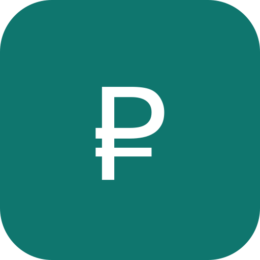
</p>

<h1 align="center">FinApp</h1>
 
**A self-hosted, open-source personal finance tracker**
 
[](https://github.com/John710/finapp/pkgs/container/finapp)
[](https://github.com/John710/finapp/releases)
[](https://github.com/John710/finapp/actions)
[](LICENSE)
 
[🇷🇺 Русская версия](/docs/README_RU.md)
 
</div>
---
 ## 📸 Screenshots

<p align="center">
  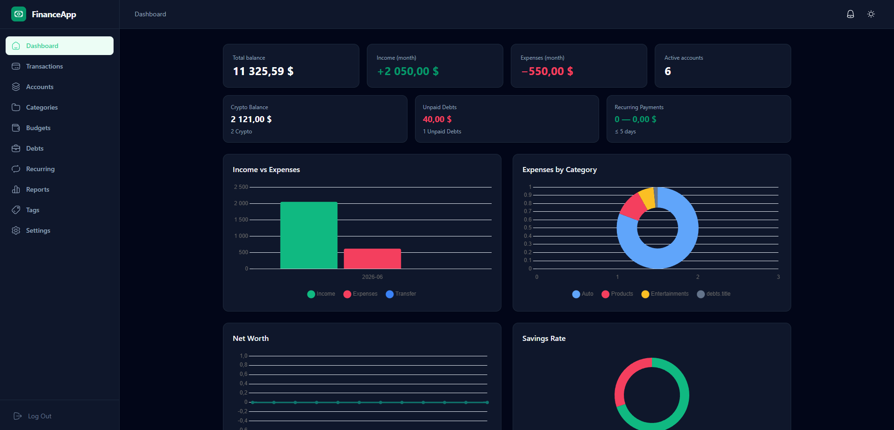
  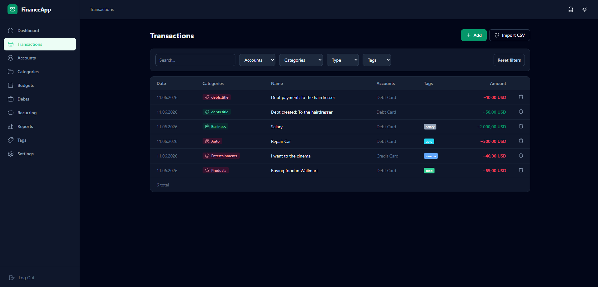
</p>

<p align="center">
  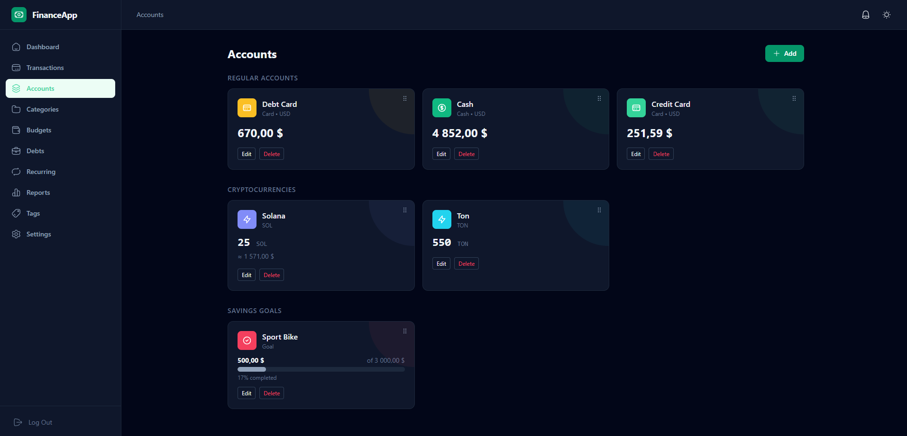
  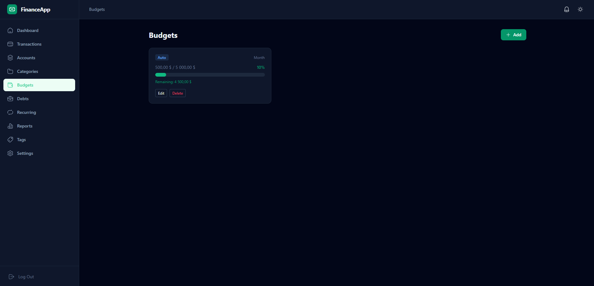
</p>

<p align="center">
  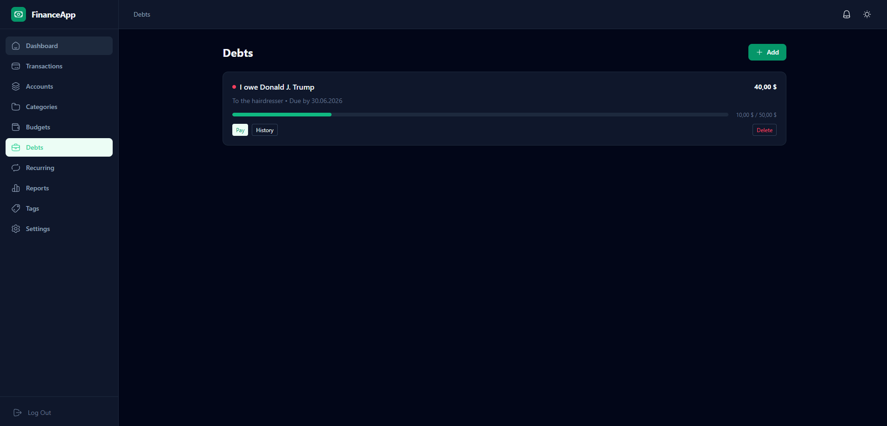
  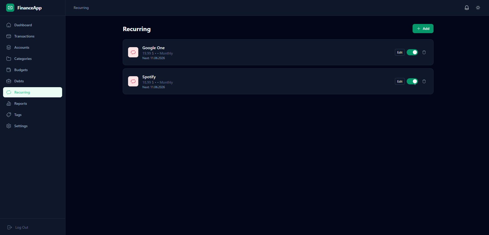
</p>

<p align="center">
  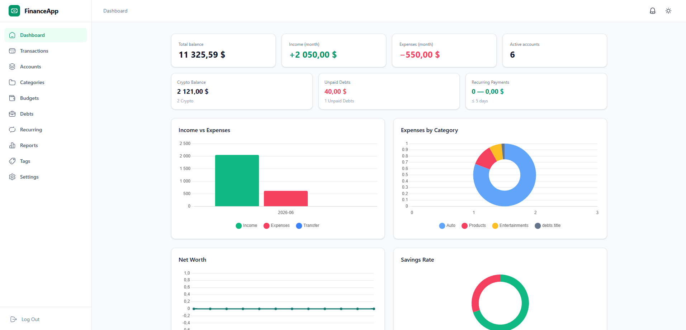
  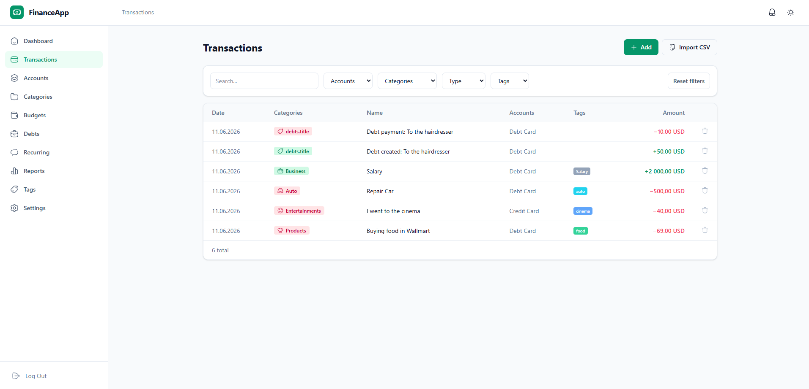
</p>

<p align="center">
  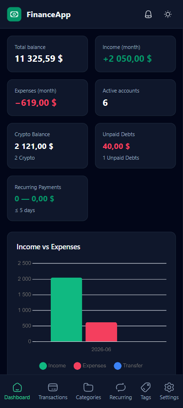
  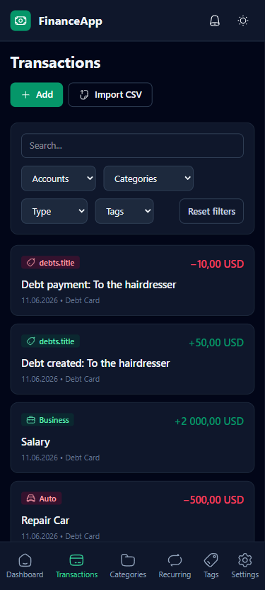
</p>
---

## ✨ Features
 
### Core Functionality
- **Income and Expense Tracking** — create transactions of different types
- **Multi-Account Support** — manage multiple accounts (cash, bank, crypto, savings)
- **Categorization** — create and use categories for transactions
- **Tags** — add additional labels for flexible filtering
- **Inter-Account Transfers** — convenient transfer tracking
### Planning & Analytics
- **Budgets** — set category limits and track spending
- **Savings Goals** — create goals and monitor progress
- **Debts** — track your debts and get due date reminders
- **Recurring Transactions** — automate recurring payments and subscriptions
- **Reports & Charts** — visualize expenses and income by category and period
### Notifications & Integrations
- **Web Push Notifications** — get browser notifications
- **Shoutrrr Integration** — send notifications to Telegram, Discord, Gotify and more
- **Smart Reminders** — automatic notifications about upcoming due dates, budget limits exceeded, etc.
### Import & Export
- **CSV Import** — import data from other finance apps
- **CSV Export** — save your data for backup purposes
### Security & Access
- **Multi-User Support** — separate accounts for family members with per-user data isolation
- **JWT Authentication** — secure app access
- **Password Encryption** — account protection
### Localization
- **Multi-Language** — English and Russian support
- **Multi-Currency** — auto-synced exchange rates including crypto
---
 
## 🚀 Quick Start
 
### Requirements
- Docker & Docker Compose
### 1. Clone the repository
```bash
git clone https://github.com/John710/finapp.git
cd finapp
```
 
### 2. Configure environment
```bash
cp .env.example .env
```
 
Edit `.env` — at minimum set:
```env
JWT_SECRET=your_random_secret_here
```

The database connection string is built automatically from `POSTGRES_USER`, `POSTGRES_PASSWORD` and `POSTGRES_DB`. If you use an external Postgres server, set `DATABASE_URL` in `docker-compose.yml` or pass it as an environment variable.
 
### 3. Start
```bash
docker compose up -d
```
 
Open `http://localhost:6253` and complete the initial setup.
 
### HTTPS / Reverse Proxy

The application does **not** enforce HTTPS or send HSTS headers itself. For production deployments, place FinApp behind a reverse proxy (Traefik, Nginx, Caddy, etc.) and configure TLS and HSTS there. This keeps plain HTTP access working for local development without breaking the app.

Example — Caddy:

```
fin.example.com {
    reverse_proxy 127.0.0.1:6253
}
```

Example — Nginx:

```nginx
server {
    listen 443 ssl;
    server_name fin.example.com;
    # ssl_certificate ...; ssl_certificate_key ...;

    location / {
        proxy_pass http://127.0.0.1:6253;
        proxy_set_header Host $host;
        proxy_set_header X-Forwarded-For $proxy_add_x_forwarded_for;
        proxy_set_header X-Forwarded-Proto $scheme;
    }
}
```

When running behind a proxy, set `TRUSTED_PROXIES` to the proxy IP/CIDR so the app reads the real client IP from `X-Forwarded-For` (used by rate limiting and security notifications).

> ⚠️ **Change the default `POSTGRES_PASSWORD`** (and `POSTGRES_USER`/`POSTGRES_DB`) if the PostgreSQL port is reachable from other machines, or if the `db` container is shared. The bundled defaults are for local use only.

### Backups

The database holds all your data — back it up regularly. The included compose file stores it in the `finapp_db_data` volume.

```bash
# Backup (adjust the container name if yours differs)
docker exec finapp-db pg_dump -U finapp -d finapp > finapp_$(date +%F).sql

# Restore
cat finapp_2026-01-01.sql | docker exec -i finapp-db psql -U finapp -d finapp
```

A daily cron example: `0 3 * * * docker exec finapp-db pg_dump -U finapp -d finapp | gzip > /backups/finapp_$(date +\%F).sql.gz`

CSV export (`Settings → Export`) is a convenience snapshot of transactions, not a full database backup.

### Upgrades

Pull the new image and recreate the container; database migrations run automatically on container start:

```bash
docker compose pull && docker compose up -d
```

The `/health` endpoint returns HTTP 503 when the database connection is lost — suitable for uptime monitoring.

---
 
## ⚙️ Environment Variables
 
| Variable | Description | Default |
|----------|-------------|---------|
| `PORT` | Server port | `6253` |
| `POSTGRES_USER` | PostgreSQL user (db service) | `finapp` |
| `POSTGRES_PASSWORD` | PostgreSQL password (db service) | `finapp` |
| `POSTGRES_DB` | PostgreSQL database (db service) | `finapp` |
| `DATABASE_URL` | Full PostgreSQL URL — only for an external database instance (compose builds it from `POSTGRES_*` automatically) | — |
| `JWT_SECRET` | JWT signing secret | — |
| `JWT_ACCESS_TTL` | Access token lifetime | `15m` |
| `JWT_REFRESH_TTL` | Refresh token lifetime | `30d` |
| `TZ` | Timezone | `UTC` |
| `ALLOWED_ORIGINS` | Allowed CORS origins (comma-separated) | — |
| `TRUSTED_PROXIES` | Trusted reverse proxies (comma-separated) | — |
| `SHOUTRRR_BLOCK_PRIVATE_TARGETS` | Reject Shoutrrr webhooks aimed at private/loopback addresses (SSRF protection for multi-user hosts) | `false` |
| `DATABASE_SSL` | Enable SSL/TLS for PostgreSQL connection | `false` |
| `DATABASE_SSL_REJECT_UNAUTHORIZED` | Reject unauthorized SSL certificates | `true` |
| `PUID` | Docker container user ID | `1000` (reuses base image `node` user) |
| `PGID` | Docker container group ID | `1000` |
| `DEFAULT_LANG` | Default language for new users (`ru` or `en`) | `en` |
| `ENCRYPTION_KEY` | 64-char hex key for sensitive user data | — |
 
---
 
## ⌨️ Keyboard Shortcuts
 
| Shortcut | Action |
|----------|--------|
| `Ctrl+Shift+K` | Open Command Palette |
| `Shift+/` | Show help |
| `Ctrl+Shift+N` | New transaction |
| `Esc` | Close modal |
| `Ctrl+Enter` | Save form |
 
---
 
## 🛠 Tech Stack
 
| Layer | Technologies |
|-------|-------------|
| **Backend** | Node.js, Fastify, PostgreSQL, JWT, Web Push, Shoutrrr |
| **Frontend** | Vue 3, Pinia, Vue Router, Vue I18n, Tailwind CSS v4, ECharts, Vite |
| **Infrastructure** | Docker, GitHub Actions, GHCR |
 
---
 
## 🔔 Notifications

Notifications are configured per-user in **Settings**:

- **Web Push** — generate your personal VAPID keys, subscribe the browser, and receive push notifications.
- **Shoutrrr** — configure one or more Shoutrrr URLs to send notifications to Telegram, Discord, Gotify, email, generic webhooks, etc.

> **Note:** Web Push requires a secure context (`https://` or `localhost`). It will not work on plain `http://` IP addresses.

The app sends automatic notifications for:
- Recurring transaction created
- Upcoming debt due date
- Budget almost exhausted
- Budget exceeded
- Savings goal reached
- Debt fully paid
- Account overdrawn
- Failed login attempt
---
 
## 📁 Project Structure
 
```
finapp/
├── backend/
│   ├── data/              # Static data (currencies)
│   ├── locales/           # i18n translations
│   ├── migrations/        # Database migrations
│   ├── plugins/           # Fastify plugins
│   ├── routes/            # API routes
│   ├── services/          # Business logic
│   └── server.js
├── frontend/
│   └── src/
│       ├── components/    # Vue components
│       ├── composables/   # Vue composables
│       ├── stores/        # Pinia stores
│       ├── views/         # Pages
│       └── router/
├── .github/workflows/     # CI/CD
├── .env.example
├── docker-compose.yml
└── Dockerfile
```
 
---
 
## 🔌 API
 
REST API available at `/api/v1`:
 
`/auth` · `/accounts` · `/transactions` · `/categories` · `/tags` · `/budgets` · `/debts` · `/recurring` · `/reports` · `/currencies` · `/import` · `/export` · `/notifications`
 
---
 
## 🧑‍💻 Local Development
 
```bash
# Backend
cd backend && npm install && npm run dev
 
# Frontend (separate terminal)
cd frontend && npm install && npm run dev
```
 
Requirements: Node.js 24+, PostgreSQL 15+

Linting: `cd backend && npm run lint` / `cd frontend && npm run lint` (ESLint + Prettier configs are included).

> ⚠️ **`npm run migrate:down` is destructive.** Several down-migrations drop columns with user data (e.g. migration 15 removes `user_id` from core tables). Always take a `pg_dump` backup before rolling anything back.

---
 
## 📄 License
 
This project is licensed under the GNU Affero General Public License v3.0 (AGPL v3) - see the [LICENSE](LICENSE) file for details.